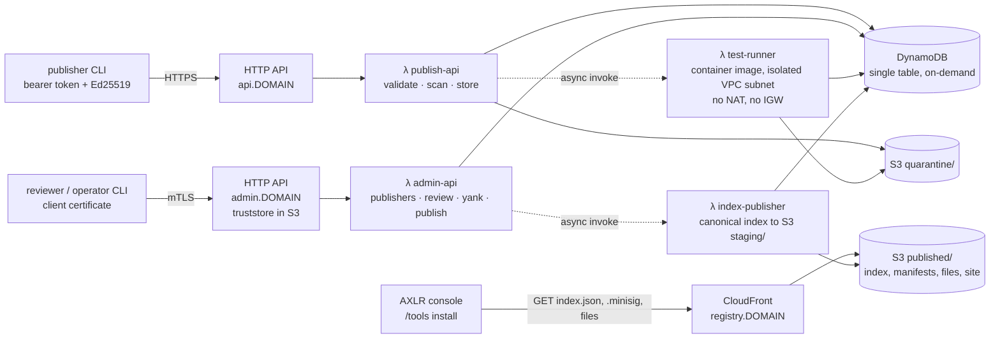

# Architecture: a serverless Rust registry that costs almost nothing to run

Status: decided on 17 Oct 2026 with Tirso; nothing deployed yet. The domain is in [`domain.md`](domain.md). This document is the service around it: hosting, data, security, code layout, tests and delivery.

## Constraints that shape everything

| Constraint | Consequence |
|:--|:--|
| Cheapest possible to maintain | no servers, no containers to patch, no databases to size: Lambda, DynamoDB on-demand, S3, CloudFront, Route 53. Idle cost is the hosted zone and the domain fee |
| Static where possible | everything the console reads (`index.json`, its signature, manifests, files, the catalog site) is static on S3 behind CloudFront; the API serves only writes and review |
| mTLS and HTTPS on our own domain | ACM certificates validated through Route 53; API Gateway HTTP API custom domains, one with mutual TLS for reviewers and operators |
| Rust microservices, hexagonal, DDD without primitive obsession, one file per type, SOLID, 80 % test coverage | a Cargo workspace with a pure domain crate, an application crate of ports and use cases, adapter crates per technology and one thin binary per Lambda |
| Two signatures, offline index key | the registry key never lives in AWS: `index-publisher` writes the unsigned canonical index; the operator signs it on their machine and uploads the `.minisig` through the admin API |

## Topology



Four Lambdas (arm64, `provided.al2023`, except the test runner):

| Lambda | Trigger | Does | Why separate |
|:--|:--|:--|:--|
| `publish-api` | HTTP API `api.DOMAIN` | authenticates the bearer token, validates the bundle, verifies the publisher signature, runs the policy scan inline (a pure function, milliseconds), writes the version and the files to `quarantine/`, invokes `test-runner` asynchronously | the only Lambda publishers can reach |
| `admin-api` | HTTP API `admin.DOMAIN` with mTLS | maps the client certificate's SHA-256 to a principal and role (the same idea as `axlr-serve`'s principals file), registers publishers, issues and revokes keys and tokens, approves, rejects, yanks, accepts the signed `.minisig`, invokes `index-publisher` | reachable only with a certificate from our private CA; the default `execute-api` endpoint is disabled |
| `test-runner` | asynchronous invoke from `publish-api` | copies the version's files from `quarantine/` to `/tmp`, runs `tests.json` with the `axlr_run_tool` contract (one JSON object on stdin, `PATH` and `HOME` only, a timeout, an output cap) and records the `TestReport` | needs `python3`, `bash` and `node`, which the OS-only runtime lacks: a container image (ECR, about $0.10 per GB-month); runs in a VPC subnet with no NAT gateway and no internet gateway, so the tool under test has no network; S3 and DynamoDB are reached through gateway endpoints, which are free |
| `index-publisher` | asynchronous invoke from `admin-api` after an approval, a yank or a key revocation | builds the canonical index from DynamoDB, writes it to `staging/index.json`, copies the approved versions' manifests and files from `quarantine/` to `published/tools/<name>/<version>/` | keeps the publish path idempotent and separate from the request that caused it |

The signed index reaches `published/index.json` only through the admin API: the operator downloads `staging/index.json`, signs it with minisign on their machine, and uploads `index.json.minisig`; `admin-api` verifies the signature against the registry's public key before copying both files to `published/` and invalidating the CloudFront paths. An index that does not verify is refused, as the console would refuse it.

## Bootstrap order (once per environment)

CloudFormation cannot create the truststore object the admin domain pins in the same pass, and CloudFront needs its certificate in `us-east-1`, so three things exist before the first `sam deploy`:

1. **The private CA**, generated offline (`openssl` or `step`); its key never enters AWS. Only `ca.pem` is uploaded.
2. **The truststore bucket**: versioned, private, created by the operator CLI or the console; `ca.pem` uploaded as `truststore/ca.pem`; its object version id is the `TruststoreVersion` parameter and the bucket name `TruststoreBucket`.
3. **The CloudFront certificate** for `registry.DOMAIN`, requested in ACM `us-east-1` with DNS validation in the hosted zone; its ARN is `CloudFrontCertificateArn`.

The API certificates, the hosted-zone records, the table, the artifact bucket, the distribution and the Lambdas are the stack's. Client certificates for reviewers and operators are issued from the CA offline and their SHA-256 registered as principals by the operator CLI.

## Data

**DynamoDB**, one table, on-demand capacity, point-in-time recovery on. The aggregates of the domain map to item families; the invariants the domain enforces in memory are enforced on write with condition expressions:

| Item | PK | SK | Condition on write |
|:--|:--|:--|:--|
| Publisher | `PUB#<id>` | `META` | `attribute_not_exists(PK)` on registration; `version = :expected` (optimistic lock) on every change |
| Publisher key | `PUB#<id>` | `KEY#<key id>` | `attribute_not_exists` on add |
| Token | `TOKEN#<digest>` | `META` (GSI-free lookup by digest) | `attribute_not_exists` |
| Tool | `TOOL#<name>` | `META` (owner, latest version) | `attribute_not_exists(PK)` on first submission: name ownership; `latest = :seen` when a version is added: strictly increasing versions |
| Tool version | `TOOL#<name>` | `VER#<version>` | `attribute_not_exists`; status changes condition on the status read (`status = :from`) |
| Audit entry | `AUDIT#<yyyy-mm>` | `<timestamp>#<ulid>` | append only; never updated or deleted |
| Principal (admin) | `PRINCIPAL#<cert sha256>` | `META` | written only by the operator CLI |

Tokens are stored as SHA-256 digests only. A GSI `GSI1` (`status`, `submitted_at`) lists the reviewer's queue.

**S3**, one bucket, versioning on, public access blocked, three prefixes: `quarantine/<status>/<name>/<version>/` (uploads and test logs; `publish-api` writes under `quarantine/rejected/` when the scan blocks, so the 90-day lifecycle rule expires only those), `staging/` (the unsigned index), `published/` (what CloudFront serves through an origin access control; nothing else is readable from the internet). The truststore for mTLS is a second, tiny, versioned bucket created before the stack (see the bootstrap order), because the custom domain pins a truststore object version.

## Security

- **Publishers**: HTTPS, a bearer token (at least 32 random bytes, shown once, stored as a digest, scoped to names) and an Ed25519 signature over the bundle digest. Both are checked by the domain, not the gateway.
- **Reviewers and operators**: mTLS on `admin.DOMAIN`, client certificates issued by a private CA generated offline (the CA key never enters AWS; the truststore holds only the CA certificate). API Gateway passes the certificate in `requestContext.authentication.clientCert`; the Lambda maps its SHA-256 to a principal with `reviewer` or `operator` role from DynamoDB. The role decides which commands may be called; the domain still refuses a reviewer approving their own publisher.
- **Server TLS**: ACM certificates for `api.`, `admin.` and `registry.` subdomains, DNS-validated in the Route 53 hosted zone. The CloudFront certificate must live in `us-east-1`; the API Gateway certificates in the deployment region.
- **The tool under test** runs in a Lambda with no network path: the subnet's route table reaches only the free S3 and DynamoDB gateway endpoints, with no NAT and no internet gateway, so the security group's egress on 443 reaches nothing else. `PATH` and `HOME` only, a timeout and an output cap. A test that tries the network fails, which is the expected result for a `network: false` tool.
- **Least privilege**: each Lambda has its own role with the table and prefixes it touches; `index-publisher` is the only writer of `published/`; GitHub deploys through an OIDC role, with no long-lived keys.
- **What the index does not prove**: see `domain.md`; "reviewed" is a verdict and the console says so.

## Cost (eu-west-1, arm64, low volume)

| Resource | Price | Expected monthly |
|:--|:--|:--|
| Lambda | 1 M requests and 400,000 GB-s free every month, then $0.20 per M | $0 |
| HTTP API | $1.00 per M requests (first 300 M) | under $0.10 |
| DynamoDB on-demand | $1.4 per M writes, $0.28 per M reads, $0.25 per GB-month | under $0.10 |
| S3 | $0.023 per GB-month, requests negligible | under $0.10 |
| CloudFront | 1 TB and 10 M requests free every month | $0 |
| ECR (test-runner image) | $0.10 per GB-month | about $0.05 |
| Route 53 | $0.50 per hosted zone-month, plus the domain's yearly fee | $0.50 + domain |
| ACM | free for public certificates | $0 |

The fixed cost is the hosted zone and the domain. Everything else scales from zero. No NAT gateway anywhere: that single line item would cost more than the rest combined.

## Code layout

```
Cargo.toml                 workspace: members, shared dependencies, lints, release profile
crates/
  domain/                  pure: no I/O, no AWS, one type per file; the invariants of domain.md
  application/             ports (traits) and use cases, one per file; depends on domain only
  adapters/
    memory/                in-memory ports for unit and use-case tests
    dynamodb/              PublisherRepository, ToolRepository, PrincipalRepository, AuditLog
    s3/                    ArtifactStore, IndexWriter
    http/                  request and response mapping shared by the API Lambdas
    lambda/                lambda_runtime glue: invoking test-runner and index-publisher
  lambdas/
    publish-api/           main.rs: wire adapters, route to use cases
    admin-api/
    test-runner/
    index-publisher/
  cli/                     axlr-registry: publisher (sign, upload), reviewer, operator (sign-index)
infra/
  template.yaml            SAM: functions, HTTP APIs with domains and mTLS, table, buckets, CloudFront, Route 53
  test-runner/Dockerfile   python3, bash, node on the Lambda base image
.github/workflows/         ci-dev.yml, ci-main.yml, release.yml
```

Rules applied: a file holds one type and its implementation; every value is a newtype that validates in its constructor and cannot be built otherwise (`PublisherId`, `ToolName`, `Version`, `Digest`, `KeyId`, `TokenDigest`, `Scope`, `Severity`, `Status`…); errors are enums, not strings; use cases depend on traits; adapters depend on use cases, never the other way; a Lambda `main.rs` only wires.

## Tests

| Kind | Where | Runs in |
|:--|:--|:--|
| Unit: every value, entity, scan rule, state transition | `crates/domain` | every push and pull request |
| Use case: each command against the in-memory adapters | `crates/application` | every push and pull request |
| Adapter integration: DynamoDB Local and MinIO as job services | `crates/adapters/*` behind a `integration` feature | merges to `main` |
| Contract: the canonical index decodes with the fields the AXLR console reads | `crates/domain` | every push |
| End to end: a signed fixture under a fresh version through upload, scan, sandbox tests, approval and the staging index, then yanked, against the deployed `staging` stack | `crates/e2e` (`cargo test -p registry-e2e -- --ignored`) | release job, before promotion |
| Coverage: `cargo llvm-cov --fail-under-lines 80`, Lambda `main.rs` files excluded; the SDK adapters count once their integration tests run under `llvm-cov` in the same job, so the gate stays honest when they land | workspace | merges to `main` |

## Delivery

GitHub's arm64 runners (`ubuntu-24.04-arm`) are free for public repositories, which this one is meant to be; a private repository would build on x86 and cross-compile with `cargo lambda build --arm64`. The deploy jobs run `sam build` (cargo-lambda for the three binaries, Docker for the runner image) before `sam deploy`; `ci-main` lints the template with `sam validate --lint`.

- `ci-dev.yml` (push to any branch, pull requests): `cargo fmt --check`, `cargo clippy --all-targets -D warnings`, `cargo test --workspace`. Minutes, with the registry and `target/` cached.
- `ci-main.yml` (push to `main`): the above, then `cargo llvm-cov` with the 80 % gate, `cargo deny check` (licences, advisories, duplicate crates), the integration tests with service containers, and `cargo lambda build --release --arm64` to prove every binary builds for the target.
- `release.yml` (tag `v*`): `cargo lambda build --release --arm64`, the test-runner image to ECR, `sam build` and `sam deploy` to the `staging` stack through the OIDC role, the end-to-end test, then `sam deploy` to `production` behind a GitHub environment that requires a reviewer. Releases carry the built binaries and their SHA-256 as assets.

## Not decided yet

The domain name and the AWS region (template parameters until then); whether `community` publishers ever exist (the domain has one channel); and the retention of quarantine objects for approved versions, kept indefinitely for now because they are the audit trail of what was reviewed.
